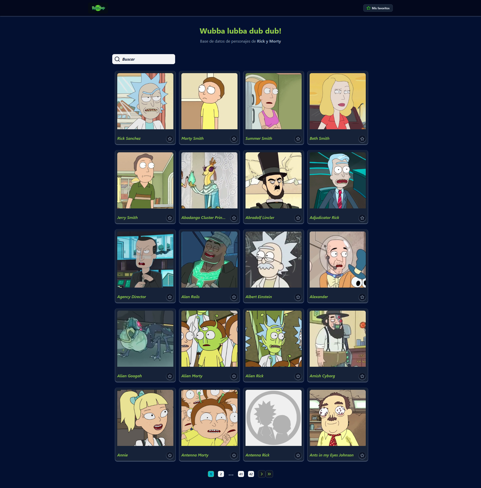
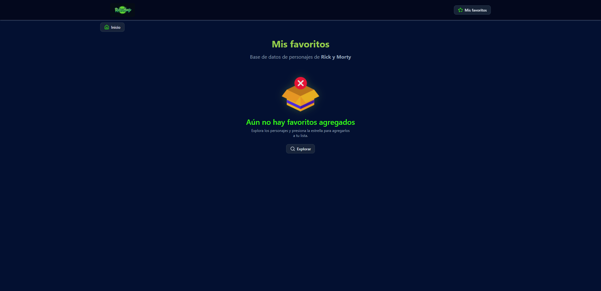

# Cards Rick y morty (API)

Sitio de dos páginas donde se muestran las cards de personajes de la carticatura de Rick y Morty.

> Se usa la API de [https://rickandmortyapi.com/](https://rickandmortyapi.com/)

> Se muestran de 20 en 20 personajes según el api las responde por página.

>Se cuenta con un buscador que permite filtrar por nombre mientras se escribe (en tiempo real).

>Cuando se escribe en el buscador y no hay resultados se muestra un mensaje de "No se encontraron resultados".

>Cuando se presiona en una card se muestra un modal con la información del personaje, se usa swiper para mostrar las imágenes del personaje.

>Cada card muestra información como el nombre, especie, estatus, genero, origen y tipo, así como su imagen principal.

>Cada card se puede agregar a favoritos, los cuales se guardan en el localStorage con zustand.

>Al pie de la página se muestra un paginador, este permite navegar entre las páginas de resultados.

> Persistencia de filtros, favoritos y paginador con useSearchParams.

## Sitio desplegado en netlify
> https://rick-y-morty-3.netlify.app/

## ¿Qué se uso durante su desarrollo?

- React
- TailwindCSS
- lucide-react
- Typescript
- React-router-dom
- Tankstack-query (react-query)
- Zustand
- Axios

## INICIO

