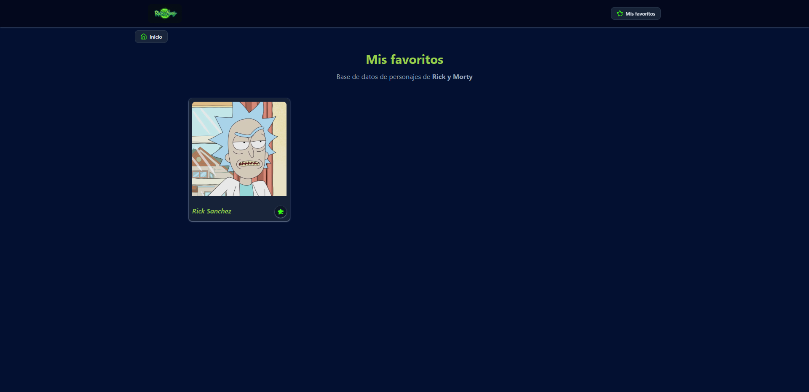

# Cards Rick y morty (API)

Sitio de dos páginas donde se muestran las cards de personajes de la carticatura de Rick y Morty.

## 💡Características

- Uso de API REST ([https://rickandmortyapi.com/](https://rickandmortyapi.com/))
- Muestra 20 personajes por página
- Paginador
- Buscador en tiempo real para filtrar por nombre
- Modal con detalle del personaje
- Función de añadir y quitar favoritos
- Persistencia de Favoritos (Zustand y storage)
- Persistencia de filtros y paginación (useSearchParams)
- Página 404
- Placeholder de estados
- Test con vitest (básico)

> **Nota: El api utilizada, suele presentar fallos al obtener datos. Se manejan intetos de petición y refetch de Tankstack**

>**Nota: El api utilizada, suele presentar fallos al mostrar las imagenes, asi que se usa una imagen de fallback**

> Se usa la API de [https://rickandmortyapi.com/](https://rickandmortyapi.com/)

## Sitio desplegado en netlify
> https://rick-y-morty-3.netlify.app/

## ¿Qué se uso durante su desarrollo?

- React
- TailwindCSS
- lucide-react
- Typescript
- React-router-dom
- Tankstack-query (react-query)
- Zustand
- Axios

## INICIO

